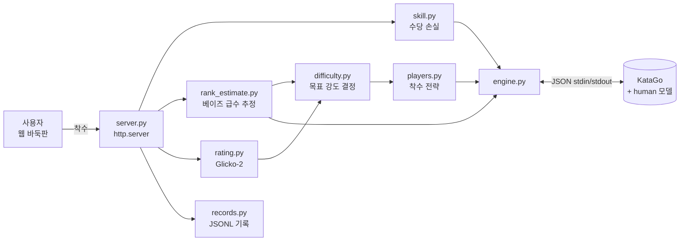

# Let's learn Go — 나와 같이 성장하는 적응형 바둑 AI

> 사용자의 실력을 **수 단위로 추정**하고, 그 실력에 맞춰 **사람 같은 실수**를 하는 바둑 상대

강한 바둑 AI는 이미 있습니다. 문제는 너무 강해서 같이 두는 재미가 없다는 점입니다. 단순히 탐색량을 줄여 약하게 만들면, 초보도 두지 않을 엉뚱한 수를 두며 져 줍니다.

이 프로젝트는 AI를 처음부터 학습시키지 않습니다. 두뇌는 오픈소스 엔진 [KataGo](https://github.com/lightvector/KataGo)에 맡기고, 그 위에 직접 설계한 두 층을 얹습니다.

1. **사용자 모델**: 이 사람은 지금 몇 급인가
2. **난이도 조절**: 그 사람과 비슷한 강도로, 그 급수 사람이 둘 법한 수를 어떻게 고를 것인가

목표는 사용자 승률이 장기적으로 **40~50%**에 머무는, 이길 듯 말 듯한 상대입니다.

---

## 주요 기능

| 기능 | 설명 |
|---|---|
| **실시간 급수 추정** | 사용자가 한 수 둘 때마다 베이즈 갱신으로 20급~9단 사이 급수 분포를 좁힘 |
| **사람형 AI (v3)** | KataGo human 모델로 "이 급수 사람이 이 국면에서 둘 수"의 분포에서 착수 |
| **자동 난이도 보정** | 판 결과로 AI 급수 오프셋과 목표 손실을 학습해 승률 45% 근처로 수렴 |
| **수 해설 카드** | AI가 왜 그 수를 뒀는지 근거 문장과 후보수 표(손실·승률·사람 선택률)로 보여 줌 |
| **힌트** | 내 추정 급수보다 조금 강한 프로필로, 손실 1집 이하이면서 사람이 둘 법한 수 최대 3개 제안 |
| **기보 보관함** | 명국·내 대국을 재생하고 판 전체를 분석: 승률 그래프, 결정적 수, 예상 밖의 명수 |
| **AI 리그전** | AI 전략끼리 대국시켜 강도와 "사람다움"을 수치로 비교 |

---

## 시스템 구조



| 층 | 역할 | 모듈 |
|---|---|---|
| 규칙 | 따냄, 패, 자충수, 중국식 계가, SGF 읽기·쓰기 | `board.py`, `sgf.py` |
| 엔진 | KataGo Analysis Engine을 subprocess로 띄워 후보수·승률·집·ownership·human 정책 질의 | `engine.py` |
| 사용자 모델 | 수당 손실, 실시간 급수 추정, Glicko-2 레이팅 | `skill.py`, `rank_estimate.py`, `rating.py` |
| 난이도 조절 | 목표 강도 결정 + 4가지 착수 전략 | `difficulty.py`, `players.py` |
| 설명 | AI 수·내 수·실력 추정의 근거 정리 | `explain.py` |
| 평가 | AI 리그전, 급수 추정 정확도 검증 | `arena.py`, `estimate_eval.py` |

---

## 핵심 알고리즘

### 1. 실력 측정: 수당 손실

사용자가 둔 수를 엔진의 최선수와 비교해 몇 집을 손해 봤는지 잽니다.

```
손실 = 최선수의 예상 집 차이 − 사용자 수의 예상 집 차이
```

승패만 보는 레이팅은 한 판에 정보가 1비트뿐이지만, 수당 손실은 한 판 안에서도 수십 번 갱신됩니다. 엔진의 값은 항상 "둘 차례" 기준으로 바꿔 두어서, 흑백 구분 없이 같은 식을 씁니다.

### 2. 실시간 급수 추정: 베이즈 갱신

KataGo human 모델은 "급수 r의 사람이 이 국면에서 각 자리에 둘 확률" `p(수 | r)`을 줍니다. 사용자가 수를 둘 때마다 급수 후보 12개 전체를 갱신합니다.

```
log P(r | 지금까지의 수) += w · log p(실제 둔 수 | r)
```

- 같은 판의 수들은 서로 독립이 아니라서(한 수가 다음 수를 강제함) 가중치 `w = 0.5`로 낮춰 과신을 막습니다.
- 12개 급수의 정책은 질의 한 번(`maxVisits=1`, 약 0.09초)으로 받습니다.
- 판이 끝나면 사후분포를 평평하게 만들어 다음 판의 사전분포로 씁니다.

별도 학습 없이 체스 [Maia](https://maiachess.com/) 연구와 같은 방식으로 급수를 추정합니다.

### 3. 난이도 조절: v1 → v2 → v3

| 버전 | 방식 | 문제 |
|---|---|---|
| v1 | 탐색량(visits) 제한 | 약해지는 방식이 부자연스러움 |
| v2 | **목표 손실 기반 수 선택**: 사용자 평균 손실 근처의 후보를 확률적으로 고름 | 손실 "크기"만 맞추고, 1선·구석 같은 사람이 안 두는 수를 둠 |
| **v3** | **human 모델**: 추정 급수 + 오프셋 프로필의 사람 정책에서 착수 | 손실 범위가 좁아 초보에겐 20급도 강함 |
| 혼합 | 사람 확률 × exp(−\|손실 − 목표\| / T) | v3의 약한 쪽 한계를 보완 |

```python
# v2: 목표 손실 근처의 후보수를 확률적으로
weight = exp(-abs(loss - target_loss) / temperature)

# 혼합: 사람이 둘 법한 수 중에서 강도를 맞춤
weight = human_prob * exp(-abs(loss - target_loss) / temperature)
```

판이 끝날 때마다 결과로 보정 계수를 갱신해, 기대값상 사용자 승률 45%에서 평형이 되게 합니다.

---

## 실험 결과

### AI 리그전 (9x9, 각 12판, 흑백 교대)

모든 플레이어의 매 수에 같은 평가 질의(200 visits + 10급 사람 정책)를 따로 던져서 공정하게 측정했습니다.

| 플레이어 | 승률 | Elo | 접전 손실(집) | 큰 실수 | 사람 top-3 |
|---|---|---|---|---|---|
| 최강 | 100% | 2101 | 0.00 | 0% | 73% |
| v3 (1단) | 75% | 1742 | 0.41 | 10% | 70% |
| v3 (5급) | 58% | 1587 | 0.78 | 20% | 78% |
| 혼합 (10급, 2집) | 50% | 1514 | 1.16 | 17% | 75% |
| v2 (1집) | 50% | 1514 | 1.21 | 11% | **30%** |
| v3 (15급) | 17% | 1163 | 1.75 | 36% | 72% |
| v2 (3집) | 0% | 879 | 2.98 | 62% | **9%** |

- **사람다움**: v3·혼합은 사람 top-3 일치율이 70~78%, v2는 9~30%입니다. v2가 "사람이 안 두는 수"를 둔다는 문제가 수치로 드러났습니다.
- **실수의 질**: 승률이 같아도 v3의 손실이 더 작습니다(v3 5급은 0.78집으로 58%, v2는 1.21집으로 50%). v3의 실수는 승부에 덜 치명적인 곳에서 나옵니다.

### 급수 추정 정확도 (9x9, 급수를 아는 봇 16판)

| 둔 수 | 3 | 5 | 10 | 20 | 30 |
|---|---|---|---|---|---|
| 가장 그럴듯한 급수가 ±1칸 안 | 31% | 56% | 75% | 89% | 87% |
| 평균 추정 오차(급수) | 4.0 | 3.7 | 2.7 | 1.9 | 1.8 |

20수만 둬도 89%가 ±1급 안으로 들어옵니다. 다만 봇은 추정에 쓰는 모델에서 직접 수를 뽑으므로, 이 수치는 실제 사람보다 쉬운 조건의 **낙관적 상한**입니다.

### 명국 분석: 이세돌 vs 알파고 4국

기보 보관함의 판 전체 분석은 "그 시대 프로가 이 수를 둘 확률"(human 모델 `proyear_2016` 프로필)도 함께 계산합니다.

- 78수 L11("신의 한 수")은 2016년 프로가 둘 확률 **0.68%(22위)** 였습니다. KataGo 기준 손실은 0집, 후보 7위입니다.
- 승부를 실제로 가른 수는 알파고 쪽의 89수 R9(승률 −26%)와 93수 S9(−25%)였습니다.

---

## 문제 해결 과정

**측정 지표가 급수 순서를 뒤집은 문제**

첫 리그전에서 강한 급수의 평균 손실이 약한 급수보다 크게 나왔습니다. 원인을 추적해 보니 대마가 죽어 승부가 기운 뒤에 매 수 수십 집씩 잡히는 손실이 평균을 지배하고 있었습니다(중앙값은 모든 급수에서 거의 0).

- 실력 지표를 **두기 전 승률 5~95%인 접전 국면의 수만**, 한 수 15집 상한으로 바꿨습니다.
- 리그전에 기권 규칙(판 넓이 30% 이후 승률 2% 미만)을 넣어 의미 없는 끝내기를 없앴습니다. 79판 중 77판이 기권으로 끝났고, 판당 시간도 약 90초에서 59초로 줄었습니다.

**v2의 부자연스러운 수**

v2는 목표 손실을 잘 따라갔지만(목표 3.0집 → 실측 3.05집), 목표가 크면 사람이 두지 않는 1선 수를 뒀습니다. 손실의 "크기"뿐 아니라 실수의 "모양"까지 맞추려고 human 모델 기반 v3로 옮겼고, 리그전의 사람 top-3 지표로 개선을 확인했습니다.

---

## 실행 방법

### 준비물

- Python 3 (3.14에서 개발·테스트, 외부 런타임 의존성 없이 표준 라이브러리만 사용)
- [KataGo](https://github.com/lightvector/KataGo) (macOS: `brew install katago`)
- KataGo human 모델 `b18c384nbt-humanv0.bin.gz`: [KataGo v1.15.0 릴리스](https://github.com/lightvector/KataGo/releases/tag/v1.15.0)에서 받아 `models/`에 넣습니다. 없으면 사람형 AI만 비활성화되고 나머지는 동작합니다.

### 실행

```bash
python3 -m venv .venv && .venv/bin/pip install pytest

# 웹 대국 → http://localhost:8000 (기보 보관함은 /library)
.venv/bin/python -m adaptive_go.server

# KataGo 경로가 Homebrew 기본값과 다를 때
.venv/bin/python -m adaptive_go.server --katago <katago> --model <모델> --config <설정>

# 터미널 대국
.venv/bin/python -m adaptive_go.play --size 9 --color B

# AI 리그전
.venv/bin/python -m adaptive_go.arena best v2:3 v3:5k mix:5k:3 --games 2 --workers 2
```

### 테스트

```bash
.venv/bin/python -m pytest -q   # 98 passed
```

`tests/fake_katago.py`가 KataGo의 JSON 프로토콜을 흉내 내서, KataGo 없이도 전체 테스트가 돌아갑니다.

---

## 기술 스택과 설계 원칙

- **Python 표준 라이브러리만 사용**: 서버는 `http.server`, 프론트는 프레임워크 없는 HTML + SVG
- **KataGo Analysis Engine**: JSON 프로토콜, human SL 모델(`humanSLProfile`), `analyzeTurns`로 판 전체 일괄 분석
- **검증된 구현**: Glicko-2는 Glickman(2013) 논문 예제로 검증했고, 규칙 엔진과 SGF 변환은 이세돌 vs 알파고 5국 기보의 수 수로 확인
- **학습용 데이터 축적**: 사용자 착수 한 수를 JSONL 한 줄로 저장(국면 복원용 수순, 엔진 평가, 손실, 소요 시간)해서 나중에 바로 학습 샘플로 쓸 수 있게 함

## 한계와 다음 단계

- 급수 보정을 자기 대국으로 했더니 순서가 섞여서, 고정 상대와의 대국(급수당 10판 이상)으로 다시 해야 합니다.
- 급수 추정은 아직 봇으로만 검증했습니다. 실제 사용자 대국 데이터로 재검증이 필요합니다.
- 웹은 로컬 1인용입니다. 세션과 다중 사용자 지원은 아직 없습니다.
- 데이터가 쌓이면 급수 조건부 수 예측 모델(Maia 방식, 9x9 ResNet)을 직접 학습하고, 내 기보로 파인튜닝한 "나를 닮은 상대"를 만들어 볼 계획입니다.

## 라이선스

MIT. 명국 기보 출처는 [library/SOURCES.md](library/SOURCES.md)에 있습니다.
